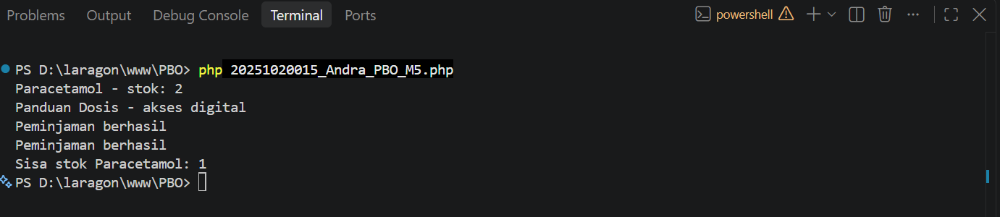

# Mini Project Advanced OOP – Pengelolaan Obat

## 1. Masalah
Program pengelolaan stok obat dari minggu sebelumnya dikembangkan agar memiliki beberapa jenis item dengan cara peminjaman yang berbeda.

## 2. Class yang digunakan
- `Obat`: abstract class untuk menyimpan data umum.
- `ObatTablet`: jenis obat fisik yang mengurangi stok saat dipinjam.
- `ObatDigital`: item digital yang tidak mengurangi stok fisik.
- `BisaDipinjam`: interface yang menetapkan method `pinjam()`.
- `DaftarPeminjaman`: menyimpan dan memproses daftar objek pinjaman.

## 3. Konsep OOP
- **Inheritance:** `ObatTablet` dan `ObatDigital` mewarisi class `Obat`.
- **Overriding:** kedua subclass memiliki method `info()` dengan hasil berbeda.
- **Polymorphism:** objek diproses melalui interface `BisaDipinjam`.
- **Abstraction:** `Obat` dibuat sebagai abstract class.
- **Interface:** `BisaDipinjam` menjadi aturan method `pinjam()`.
- **Composition:** `DaftarPeminjaman` menyimpan beberapa objek yang bisa dipinjam.

## 4. Validasi dan pengujian
Nama obat tidak boleh kosong dan stok tidak boleh negatif. Program menguji peminjaman obat tablet dan item digital. Obat tablet mengurangi stok, sedangkan item digital tidak mengurangi stok fisik.

## 5. Screenshot hasil program
Simpan screenshot output program di folder root repository (sejajar dengan file README.md). Ganti nama file screenshot sesuai nama yang digunakan di bawah, atau sesuaikan path pada Markdown jika nama file berbeda.



## 6. Cara menjalankan
Jalankan perintah berikut dari terminal pada folder project:

```bash
php 20251020015_Andra_PBO_M5.php
```

## 7. Kesimpulan
Konsep Advanced OOP membuat program lebih mudah dikembangkan saat ada jenis obat baru dengan perilaku yang berbeda.
